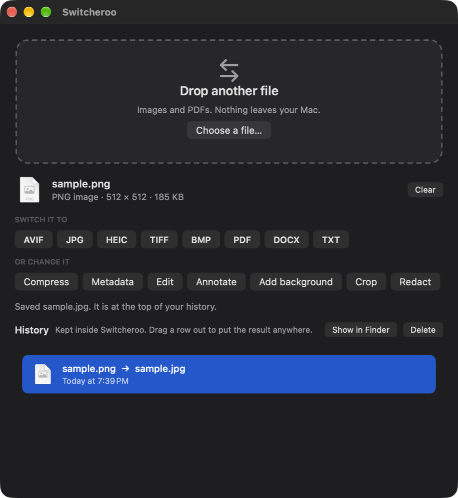

<p align="center">
  
</p>

<p align="center">
  <strong>Switcheroo</strong><br>
  <sub>Switch a file into what you need: drop an image or PDF, see what it is, and choose what it becomes</sub>
</p>

<p align="center">
  <a href="https://github.com/markadebartolo/Switcheroo/releases/latest"><strong>Download for Mac</strong></a>
  &nbsp;·&nbsp;
  <a href="https://github.com/markadebartolo/Switcheroo/releases">All releases</a>
</p>

<p align="center">
  
</p>

---

## Why Switcheroo

Converting a screenshot, cropping a photo or pulling the text out of a PDF usually means opening an app,
finding the file, exporting, and naming the result. Switcheroo is one window: drop a file on it, it tells
you what the file is, and you click what you want it to be. The result is kept beside a copy of the
original, in the app's own history. Everything runs on your Mac: no account, no network calls, no third-party code.

## Features

- **Convert** between PNG, JPG, HEIC, TIFF, BMP and PDF. WebP and AVIF appear when your Mac can write them.
- **PDF to images**: every page becomes its own numbered image.
- **Text out of anything**: TXT or an editable DOCX from a PDF's text, with on-device OCR for scans and photos.
- **Crop** by dragging, by aspect ratio or by exact pixel size.
- **Add a background**: color and gradient presets, padding, rounded corners, shadow, and 1:1, 16:9 or 4:3 canvases.
- **Compress** to a JPEG quality and a longest edge, never upscaling.
- **Edit** brightness, contrast, saturation and rotation.
- **Annotate** with text labels and outline rectangles.
- **Redact** by replacing the selected pixels with solid black in a new flattened image.
- **Metadata**: see what an image or PDF carries, and save a clean copy without EXIF or GPS data.
- **Nothing is overwritten, nothing to tidy.** Every switch is kept in the app's history, the original beside the result. Drag a row out of the window to put the result wherever you want it.
- **An action wheel too**, if you prefer it: the same actions in a ring at your cursor.
- **Your color**: choose the wheel's color in Settings, from seven ready-made colors or any color you like.
- **Menu bar only**: no Dock icon and no background services.

## Get started

1. Download **Switcheroo-macos.zip** from [Releases](https://github.com/markadebartolo/Switcheroo/releases/latest) and unzip it.
2. Move **Switcheroo.app** to your Applications folder and open it.
3. Drop a file on the window. Switcheroo shows what it is: its type, size and dimensions or page count.
4. Click the format to switch it to, or a tool to crop, compress, annotate or redact it.
5. The result appears at the top of **History**. Drag it out of the window, double-click it to open it, or choose **Show in Finder**.

### Who can use the download

| | |
|--|--|
| **Works on** | Apple Silicon and Intel Macs · macOS 13 Ventura or later |
| **File** | `Switcheroo-macos.zip`, a universal build |
| **Signed** | Developer ID, notarized by Apple |

## Using the wheel

Choose **Show action wheel** from the menu bar icon for the same actions in a ring at your cursor.

| Key or action | What it does |
|--|--|
| **Tab** | Switches the wheel between converting and editing tools |
| **Arrow keys, Return** | Select an action and run it |
| **Number keys** | Pick a sector, counting clockwise from the top |
| **Escape** | Closes the wheel |
| **Center of the wheel** | Switches wheels when files are loaded; opens the file chooser when none are |
| **Option (⌥) while dragging** | Switches to the editing tools |

**Show wheel while dragging files** in the menu makes the wheel appear by itself when you start dragging a
file in Finder. It is off until you turn it on. **Open With → Switcheroo** in Finder works as well.

**Settings…** (⌘,) changes the color of the wheel.

History is kept inside the app (`~/Library/Application Support/Switcheroo/History`), with a `Before` and an
`After` folder for every switch. Use **History folder → Choose folder…** to keep it somewhere you choose.

## Limits worth knowing

- Editing tools work on one file at a time. For a PDF you choose the page to export as an image; Switcheroo does not rewrite or redact a whole PDF.
- DOCX export keeps the text, not the original layout, columns or tables. OCR can make mistakes, so read its output.
- Animated and multi-frame images use their first frame. Video, audio and folders are not handled.
- Images are limited to 64 megapixels and 16,000 pixels on a side. PDF pages are rendered at about 144 dpi.
- Compressing an image that is already well compressed may not make it smaller.

## Build from source

You need macOS 13 or later and Apple's Command Line Tools (`xcode-select --install`). No Xcode project and
no packages are required.

```bash
bash scripts/build.sh
open build/Switcheroo.app
```

The build compiles the app, draws its icon, signs it for local use and runs the self-test: checks of
decoding, cropping, resizing, rotation, redaction, PDF conversion, DOCX structure, name collisions and
wheel hit testing against the real macOS frameworks. `bash scripts/validate.sh` repeats that from a clean
folder and inspects the finished bundle. `Tests/Mac-acceptance.md` lists what is checked by hand.

`Install.command` builds the app and puts it in `~/Applications` in one step.

**Sign and notarize** with your own Developer ID:

```bash
SIGN_IDENTITY="Developer ID Application: Your Name (TEAMID)" NOTARY_PROFILE="your-profile" bash scripts/release.sh
```

That makes `dist/Switcheroo-macos.zip`, a universal build, stapled and ready to attach to a release.

## How it is put together

Swift and AppKit only, in `Sources/Switcheroo`:

| File | What it holds |
|--|--|
| `AppDelegate.swift` | The menu bar item, drag detection, choosing files, where results go |
| `MainWindow.swift` | The window: the drop zone, what a file can become, and the history |
| `Wheel.swift` | The translucent wheel, its drop targets, keyboard control and accessibility labels |
| `WheelTheme.swift` | The wheel's color and the Settings window that changes it |
| `Canvas.swift` | Crop selection and the annotate and redact interactions |
| `Editor.swift` | The editing windows and their controls |
| `ImageEngine.swift` | Rendering, conversion, OCR, image effects and collision-safe saving |
| `OutputStore.swift` | The timestamped `Before` and `After` folders |
| `DocxWriter.swift` | DOCX files written without any library |
| `SelfTest.swift` | The checks the build runs |

## Remove it

Quit Switcheroo from its menu and move the app to the Trash. It installs no launch agents, Finder
extensions or background services. Your history stays in `~/Library/Application Support/Switcheroo` until
you delete it.

---

<p align="center">
  <sub>Menu bar · On-device only · Originals always kept</sub>
</p>
